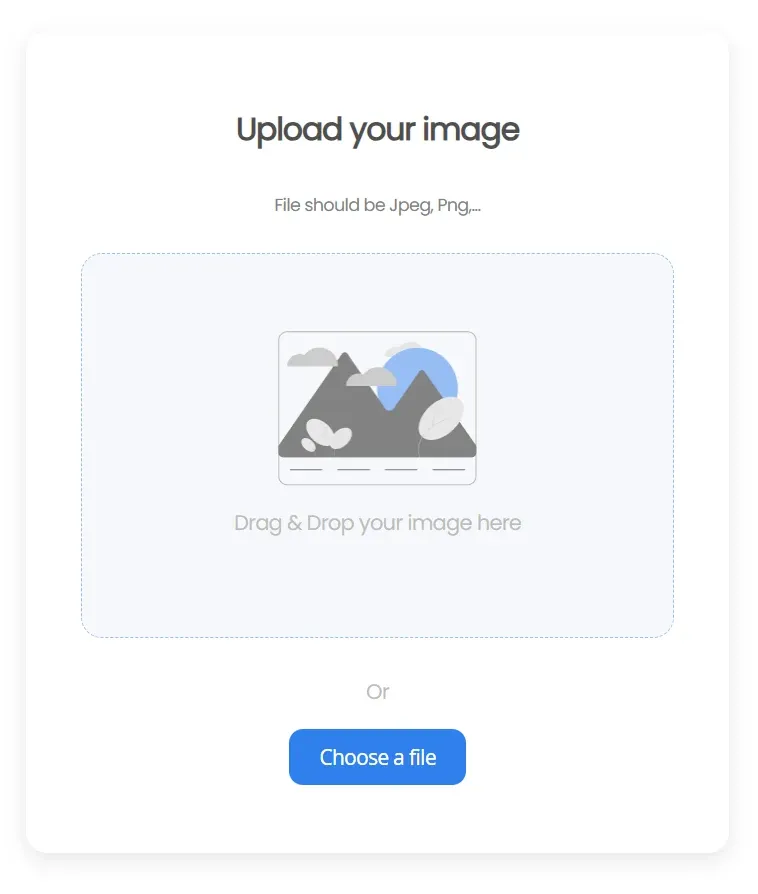

# Image Uploader

This is a simple site to upload your image and share it with everybody! It's made with React, HTML and CSS.

## Demo



If you want to try it you can go [here!](https://upload-your-image.netlify.app)

## Features

- Drag & drop or choose a file from your device.
- Accepts **PNG or JPEG** images up to **2 MB**. The browser checks it first and the API checks it again before storing anything.
- Every image gets a unique name, so you always get your own link to share, even if another file has the same name.

## Run Locally

Clone the project

```bash
  git clone https://github.com/ericveganoguera/image-uploader
```

Go to the project directory

```bash
  cd image-uploader
```

Install dependencies

```bash
  npm install
```

Create a `.env` file with the URLs of the API

```
REACT_APP_URL_API=http://localhost:5005/upload
REACT_APP_BASE_URL_API=http://localhost:5005/
```

Start the app

```bash
  npm start
```

You'll need the API project running too, go [here](https://github.com/ericveganoguera/image-uploader-api) if you want to check the repo.

## Authors

- [@ericveganoguera](https://github.com/ericveganoguera/)
